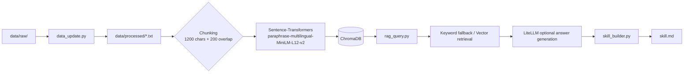

> **第十週作業（HW10：LLM Wiki → 教學簡報）請看 [`HW10_REPORT.md`](HW10_REPORT.md)。** 以下是 HW3 的原始說明，HW3 的檔案都保留。

# AIASE2026-HW3 — U.S. Consumer Staples & Retail Financial Reports RAG

## 1. 專案簡介

本專案建構一個以**美國消費必需品與零售公司公開財報文件**為主題的輕量化 RAG 系統，目標不是做泛用問答，而是聚焦在：

- 10-K 年報的結構化閱讀
- earnings call transcript 的季度更新訊號整理
- 跨公司基本面比較
- 自動產出可供 Agent 使用的 `skill.md`

我選擇這個主題的原因有三個：

1. **主題邊界明確**：資料集中在特定產業與固定公司，不會變成過度發散的「全部財經資料」。
2. **資料可持續更新**：年報與法說會逐字稿會持續產生，符合作業要求的可持續性。
3. **最終 skill 具有實用價值**：完成後的 `skill.md` 可以直接作為研究助手、財報摘要助手、跨公司比較助手的知識底稿。

目前知識庫覆蓋 5 家公司、20 份文件：

- **KHC** — The Kraft Heinz Company
- **KMB** — Kimberly-Clark Corporation
- **KO** — The Coca-Cola Company
- **PG** — The Procter & Gamble Company
- **WMT** — Walmart Inc.

資料型態包含：

- **5 份 10-K 年報**
- **15 份 earnings call transcripts**

期間大致落在：

- **FY2025 / FY2026 annual reports**
- **2025 Q2 / Q3 / Q4** 或 **FY2026 Q2 / Q3 / Q4** 法說會

這個 RAG 系統特別適合回答以下類型問題：

- 哪家公司本季成長更依賴 volume、price 還是 mix？
- 管理層近期最擔心的風險與成本壓力是什麼？
- 哪些品牌、通路、促銷與創新策略被反覆提及？
- 品牌商與零售商對消費者需求的看法有什麼差異？
- 如何把這批公開文件濃縮成可供 Agent 使用的 `skill.md`？

---

## 2. 系統架構說明（含 Mermaid 圖）



### 系統流程說明

1. `data/raw/` 放入原始 PDF / TXT / MD 文件。
2. `data_update.py` 先做抽字、清理、輸出 `data/processed/*.txt`。
3. 再將 processed text 切 chunk，預設採 **1200 字元 + 200 overlap**。
4. 若 embedding 開啟，會使用 `sentence-transformers` 建立向量並寫入 `ChromaDB`。
5. `rag_query.py` 可用 vector search，若向量環境不可用則退回 keyword fallback。
6. `skill_builder.py` 透過多個全域問題掃描整個知識庫，整合後輸出 `skill.md`。

---

## 3. 設計決策說明（Design Decisions）

### 3-1. Chunking 策略

本專案採用**固定長度 chunking**：

- `chunk_size = 1200`
- `overlap = 200`

選擇理由：

1. 10-K 與 transcript 都屬於長篇文字，若完全依段落切分，常會遇到段落過長或格式不規則的問題。
2. 固定長度對於 PDF 清理後的文本更穩定，不會因來源 vendor 不同而出現太大落差。
3. 加入 overlap 可降低「句意剛好切斷」的機率，對法說會問答段落特別有幫助。

這個策略不是最精細的語意切分，但對本作業來說具有：

- 實作穩定
- 好 debug
- 可重複執行
- 足夠支撐 retrieval

### 3-2. Embedding 模型選擇

本專案選用：

- `sentence-transformers`
- `paraphrase-multilingual-MiniLM-L12-v2`

理由：

1. **完全免費、本地可執行**，不依賴付費 embedding API。
2. 支援中英文混合查詢。雖然資料主體是英文，但實際使用常是中文提問搭配英文公司名、品牌名與財務術語。
3. 對作業環境來說，比 API 方案更容易複現，也比較符合 `.env.example` 中免費方案的精神。

### 3-3. Vector DB 選型

本專案使用：

- **ChromaDB**

理由：

1. 不需要另外啟動 server，複現成本低。
2. 對作業規模來說已足夠，且能直接以本地 persist 方式保存向量資料。
3. 相較 pgvector，Chroma 對單機作業提交更輕量，也避免 Docker / DB 啟動步驟增加複現風險。

因此本專案**不需要 `docker-compose.yml`**；README 中也會明確說明本專案採用 ChromaDB，本地直接執行即可。

### 3-4. Retrieval 策略

`rag_query.py` 支援三種模式：

- `auto`
- `vector`
- `keyword`

建議使用：

- `auto`

原因：

1. 優先走 vector search，符合完整 RAG 路徑。
2. 若環境缺少向量依賴、模型無法下載或資料庫不可用，仍可退回 keyword fallback，避免整支 CLI 完全失效。
3. keyword fallback 額外做了以下補強：
   - BM25-like scoring
   - metadata boost
   - company / period matching
   - document family matching
   - concept alias expansion
   - transcript junk penalty

這樣的設計比單純全文搜尋更接近可用的 baseline RAG。

### 3-5. Prompt Engineering

本專案在 `rag_query.py` 中採用的核心策略是：

- 先把 retrieved chunks 與 metadata 一起組成 context block
- 要求 LLM **只根據檢索內容回答**
- 要求答案以繁體中文輸出
- 要求答案標註來源 `[1] [2] ...`

如果 LiteLLM 未設定或呼叫失敗，則退回 extractive answer。這樣可以確保：

- 不會因為 TA 尚未提供 LLM key 而整體失效
- 仍保有「可引用來源」的基礎問答能力

### 3-6. Idempotency 設計

`data_update.py` 的設計重點是：

1. **支援 `--rebuild`**
   - 刪除 `data/processed/`
   - 刪除 `manifest.json`
   - 重建索引

2. **預設增量更新**
   - 透過 `sha256` 比較檔案是否改變
   - 未變動檔案直接跳過

3. **同步刪除已不存在的 raw 檔案**
   - 若 `data/raw/` 中的檔案被移除
   - 會同步刪除 `data/processed/` 對應 `.txt`
   - 會從 `manifest.json` 移除
   - 若 embedding 開啟，會同步自 Chroma 刪除該檔案對應 chunks

4. **清理與索引解耦**
   - 先輸出 `processed/*.txt`
   - 再做 chunk / embedding

這樣的設計有助於作業要求的冪等性與重跑穩定性。

### 3-7. `skill_builder.py` 問題設計

`skill_builder.py` 不是只問一題，而是用多個全域問題掃描整個知識庫，例如：

- 這個知識庫涵蓋哪些主要概念、子主題與分析範圍？
- 從這批 10-K 與 earnings call 來看，最重要的成長驅動因素、風險與管理層關注點是什麼？
- 各公司管理層反覆提到哪些策略、品牌、通路、成本、價格或需求因素？
- 這個知識庫中的關鍵實體有哪些？
- 若把這個知識庫整理成研究框架，最值得保留的方法論與最佳實踐是什麼？
- 這個知識庫目前的知識邊界與限制是什麼？

這種設計比單一總結更穩，因為它把 skill.md 拆成多個 section 來源，再整合成最終文件。

---

## 4. 環境設定與執行方式

### 4-1. Python 版本與虛擬環境

**已驗證版本：Python 3.11.x（建議 3.11.9）**

本專案提交與複現請優先使用 **Python 3.11.x**。雖然作業規格接受 `>= 3.10`，但考量 `torch`、`sentence-transformers` 與 `chromadb` 的安裝相容性，較新的 Python 版本可能出現依賴安裝問題。因此，本 README 所列測試與重現步驟，均以 **Python 3.11.x** 為主要參考環境。

```bash
# ① 確認 Python 版本
python3 --version
# 建議：Python 3.11.x

# ② 建立並啟動虛擬環境
python3 -m venv .venv
source .venv/bin/activate

# ③ 升級 pip
pip install --upgrade pip

# ④ 安裝套件
pip install -r requirements.txt
```

若遇到 Linux 系統的 `externally-managed-environment` 問題，請務必使用上述 venv 方式，不要直接在系統 Python 安裝。

### 4-2. 環境變數設定

```bash
cp .env.example .env
```

必要欄位：

- `EMBEDDING_PROVIDER=sentence-transformers`
- `EMBEDDING_MODEL=paraphrase-multilingual-MiniLM-L12-v2`
- `CHROMA_PERSIST_DIR=./chroma_db`

若 TA 已提供 LiteLLM，請填入：

- `LITELLM_API_KEY`
- `LITELLM_BASE_URL`
- 視需要調整 `LITELLM_MODEL`

### 4-3. Vector DB 啟動

本專案使用 **ChromaDB**，屬於純 Python 本地持久化方案，**不需要 `docker-compose.yml`**。

因此本專案的複現流程中：

- 不需要 `docker compose up -d`
- 不需要額外 DB server
- 不需要獨立資料庫帳密設定

### 4-4. 執行路徑說明

本專案提供兩種正式執行路徑：

#### 路徑 A：完整向量路徑
適用於已成功安裝向量依賴，且可正常建立 embeddings / ChromaDB 的環境。

```bash
# ① 確認 Python 版本
python3 --version

# ② 建立並啟動虛擬環境
python3 -m venv .venv
source .venv/bin/activate

# ③ 安裝套件
pip install --upgrade pip
pip install -r requirements.txt

# ④ 設定環境變數
cp .env.example .env
# 如有 TA 提供的 LiteLLM 設定，請填入 .env

# ⑤ 全量重建索引
python data_update.py --rebuild

# ⑥ 測試 RAG 問答
python rag_query.py --query "請問這個知識庫的核心主題是什麼？"

# ⑦ 生成 Skill 文件
python skill_builder.py --output skill.md
```

#### 路徑 B：無向量 fallback 路徑
適用於當前環境缺少向量依賴、模型下載受限，或僅需先驗證 CLI、資料清理與 keyword retrieval 流程的情況。

```bash
python data_update.py --rebuild --skip-embedding
python rag_query.py --query "請問這個知識庫的核心主題是什麼？" --mode keyword
python skill_builder.py --output skill.md --mode keyword
```

### 4-5. 本專案建議測試指令

```bash
python data_update.py --help
python rag_query.py --help
python skill_builder.py --help
python data_update.py --rebuild --skip-embedding
python rag_query.py --query "Walmart Q4 FY2026 的核心重點是什麼？" --mode keyword --show-context
python skill_builder.py --output skill.md --mode keyword
```

---

## 5. 資料來源聲明（Data Sources Statement）

本專案僅使用公開、可合法取得的文件，來源類型如下：

| 來源名稱 | 類型 | 授權 / 合規依據 | 數量 |
|---|---|---|---:|
| SEC Form 10-K | PDF | 美國 SEC 公開公司揭露文件 | 5 |
| FactSet earnings call transcript | PDF | 公開取得之 transcript 輸出 / 使用者自備文件 | 6 |
| Motley Fool earnings transcript | PDF | 公開文章轉存 / 使用者自備文件 | 5 |
| Seeking Alpha transcript | PDF | 公開文章轉存 / 使用者自備文件 | 1 |
| InsiderMonkey transcript | PDF | 公開文章轉存 / 使用者自備文件 | 1 |
| StockInsights transcript summary | PDF | 公開頁面轉存 / 使用者自備文件 | 2 |

### 實際文件清單

#### KHC
- `KHC_10K_FY2025_SEC.pdf`
- `KHC_Transcript_Q2_2025_InsiderMonkey.pdf`
- `KHC_Transcript_Q3_2025_SeekingAlpha.pdf`
- `KHC_Transcript_Q4_2025_MotleyFool.pdf`

#### KMB
- `KMB_10K_FY2025_SEC.pdf`
- `KMB_Transcript_Q2_2025_MotleyFool.pdf`
- `KMB_Transcript_Q3_2025_MotleyFool.pdf`
- `KMB_Transcript_Q4_2025_MotleyFool.pdf`

#### KO
- `KO_10K_FY2025_SEC.pdf`
- `KO_Transcript_Q2_2025_FactSet.pdf`
- `KO_Transcript_Q3_2025_FactSet.pdf`
- `KO_Transcript_Q4_2025_FactSet.pdf`

#### PG
- `PG_10K_FY2025_SEC.pdf`
- `PG_Transcript_Q2_FY2026_MotleyFool.pdf`
- `PG_Transcript_Q3_FY2025_StockInsights.pdf`
- `PG_Transcript_Q4_FY2025_StockInsights.pdf`

#### WMT
- `WMT_10K_FY2026_SEC.pdf`
- `WMT_Transcript_Q2_FY2026_FactSet.pdf`
- `WMT_Transcript_Q3_FY2026_FactSet.pdf`
- `WMT_Transcript_Q4_FY2026_FactSet.pdf`

---

## 6. 系統限制與未來改進

### 目前限制

1. **Python 版本相容性仍以 3.11.x 最穩**  
   雖然規格接受 `>= 3.10`，但在較新的 Python 版本下，某些套件組合可能出現安裝相容性問題。本 README 所列測試與重現步驟，應以 Python 3.11.x 為主要參考環境。

2. **第一次 embedding 依賴本地模型下載**  
   `sentence-transformers` 首次執行時通常需要下載模型；若環境無法連線，需先改用 `--skip-embedding` 或預先快取模型。

3. **transcript vendor 品質不一**  
   某些來源夾帶網站導覽、摘要塊或廣告性文字，因此清理雖已做處理，仍可能保留少量噪音。

4. **keyword fallback 雖可用，但不等於完整語意檢索**  
   它可以保住 CLI 可用性，但效果仍不如完整 embedding + vector retrieval。

5. **`skill.md` 目前仍受來源品質影響**  
   若 transcript 原始品質弱，則自動萃取結果也會受影響，因此高品質 source selection 仍是後續重點。

### 未來改進方向

1. 改善 transcript 清理規則，針對不同 vendor 做更細的 source-specific cleaning。
2. 為 vector retrieval 增加更明確的 metadata filter，例如公司、季度、文件類型過濾。
3. 提升 `skill_builder.py` 的摘要品質，讓 `Overview / Key Trends / Example Q&A` 更穩定、更像研究筆記而非 extractive 摘錄。
4. 增加更多年度與季度文件，將知識庫從 snapshot 擴充成 time-series corpus。
5. 若時間允許，可加入 reranking 或 hybrid retrieval，提升長文件檢索品質。

---

## 7. 必要檔案與目錄結構

```text
AIASE2026-HW3/
├── data/
│   ├── raw/
│   ├── processed/
│   └── manifest.json
├── data_update.py
├── rag_query.py
├── skill_builder.py
├── skill.md
├── README.md
├── requirements.txt
└── .env.example
```

---

## 8. 建議提交前自我檢查清單

- [ ] `python data_update.py --help` 可執行
- [ ] `python rag_query.py --help` 可執行
- [ ] `python skill_builder.py --help` 可執行
- [ ] `data/raw/` 至少有 20 份文件
- [ ] `data/processed/` 已存在且有清理後 `.txt`
- [ ] `python data_update.py --rebuild` 可跑完
- [ ] `python rag_query.py --query "..."` 可回應並附來源
- [ ] `python skill_builder.py --output skill.md` 可產出文件
- [ ] `skill.md` 章節完整
- [ ] `.env.example` 不含真實金鑰
